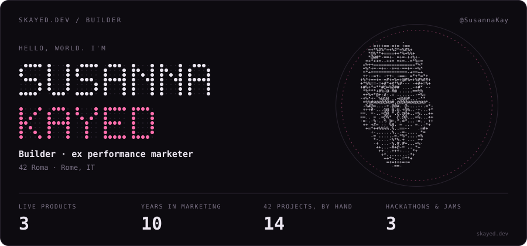
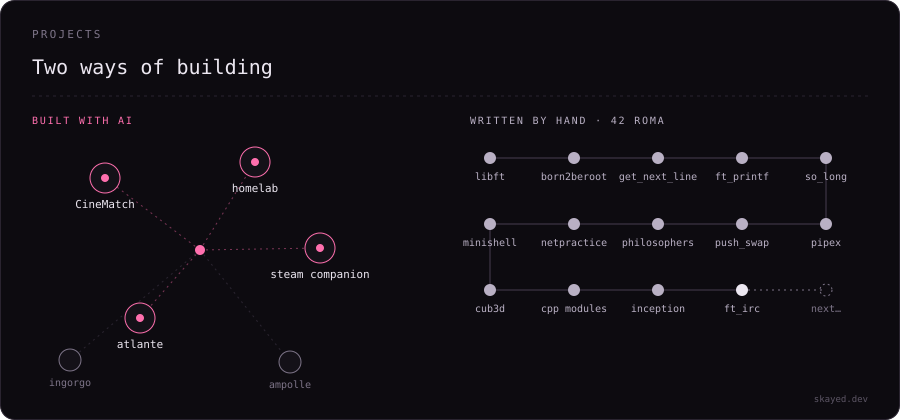
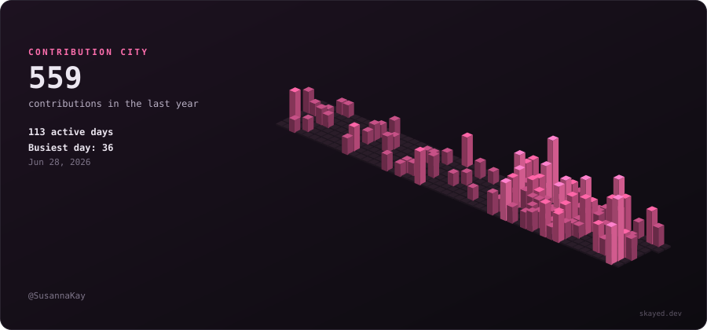

<p align="center">
  
</p>

<p align="center">
  <a href="https://skayed.dev">skayed.dev</a> · <a href="https://www.linkedin.com/in/susanna-kayed">LinkedIn</a> · <a href="mailto:susanna.kayed@gmail.com">Email</a>
</p>

```console
sus@skayed:~$ ls -skills

languages/     C   C++   Python   TypeScript   JavaScript   Shell
ai-building/   Claude Code   Codex   Lovable   Ollama   LLM APIs   RAG
infra/         Docker   Linux   Git   Vercel   Tailscale

sus@skayed:~$ ▍
```

I spent ten years in performance marketing, measuring what works for people. Then I chose to build things instead of selling them.

Now I turn ideas into working products. AI writes fast; 42 taught me what's underneath, so I can tell it to behave. Most of my side projects are built with AI. My 42 projects are written by hand.

<p align="center">
  
</p>

[Steam Companion](https://steam-companion-bay.vercel.app) · [CineMatch](https://github.com/SusannaKay/CineMatch) · [homelab](https://github.com/SusannaKay/homelab) · [Atlante](https://github.com/SusannaKay/MacOs_atlante) · [42 C++ notes](https://github.com/SusannaKay/42_CPP) · [Ingorgo!](https://ingorgo.vercel.app) · [Ampolle!](https://ampolle.vercel.app)

## Side quests

Brainyard at HackRome 2026 (backend) · Chewse, a 2-day AI hackathon · Game jam in Matera, 2nd place at the Lucania Film Festival

<p align="center">
  
</p>

<p align="center">
  Have an idea worth building? <a href="https://skayed.dev/#terminal">Write to me</a>, it lands on my phone.
</p>
